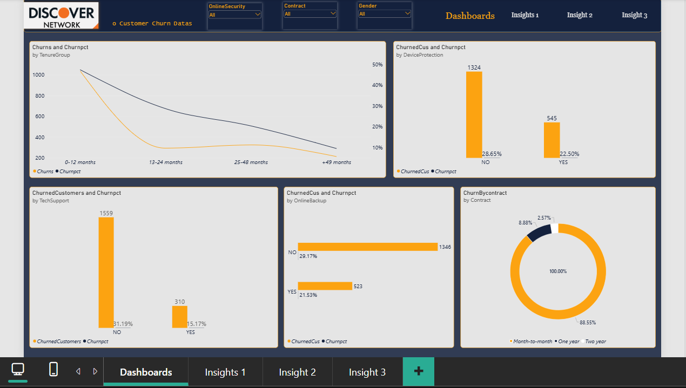
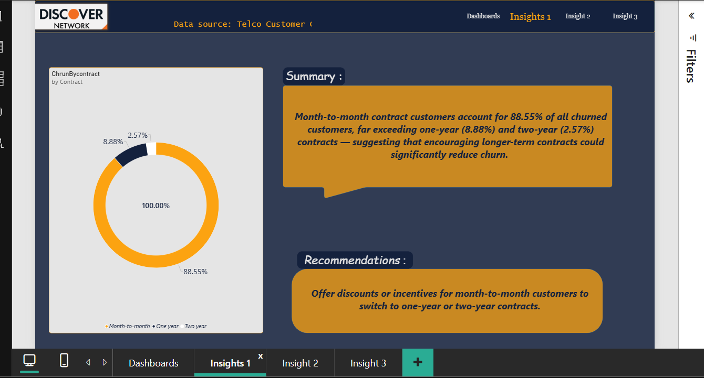
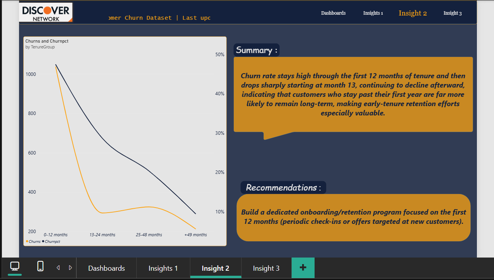
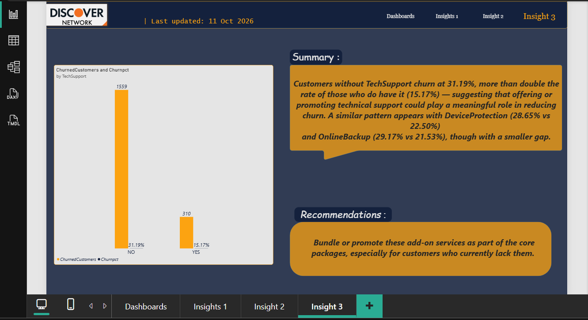

# telco-churn-analysis

## Data Cleaning

Data cleaning and transformation were performed using SQL before loading the dataset into Power BI:

- Replaced `NULL` / `"No internet service"` values with `0` in internet-dependent columns (OnlineSecurity, OnlineBackup, DeviceProtection, TechSupport, StreamingTV, StreamingMovies) wherever InternetService = 0, since these fields are not applicable to customers without internet service.
- Replaced `NULL` / `"No phone service"` values with `0` in phone-dependent columns (MultipleLines) wherever PhoneService = 0, for the same reason.
- Rounded the `TotalCharges` and `MonthlyCharges` columns to improve readability and consistency.

After loading the cleaned dataset into Power BI, the binary columns initially displayed as "Yes"/"No" instead of 0/1. This was corrected using Power Query's **Replace Values** feature to restore the 0/1 format used for visualizations and calculations.

## Dashboard Previews

### Dashboard 1: Dashboards

### Dashboard 2: Insight 1

### Dashboard 3: Insight 2

### Dashboard 4: Insight 3

## Key Insights

1. **Contract Type**
Month-to-month contract customers account for 88.55% of all churned customers, far exceeding one-year (8.88%) and two-year (2.57%) contracts — suggesting that encouraging longer-term contracts could significantly reduce churn.

**Recommendation:** Offer discounts or incentives for month-to-month customers to switch to one-year or two-year contracts.

2. **Tenure**
Churn rate stays high through the first 12 months of tenure and then drops sharply starting at month 13, continuing to decline afterward — indicating that customers who stay past their first year are far more likely to remain long-term, making early-tenure retention efforts especially valuable.

**Recommendation:** Build a dedicated onboarding/retention program focused on the first 12 months (periodic check-ins or offers targeted at new customers).

3. **Support & Add-on Services**
Customers without TechSupport churn at 31.19%, more than double the rate of those who do have it (15.17%) — suggesting that offering or promoting technical support could play a meaningful role in reducing churn. A similar pattern appears with DeviceProtection (28.65% vs. 22.50%) and OnlineBackup (29.17% vs. 21.53%), though with a smaller gap.

**Recommendation:** Bundle or promote these add-on services as part of the core packages, especially for customers who currently lack them.
